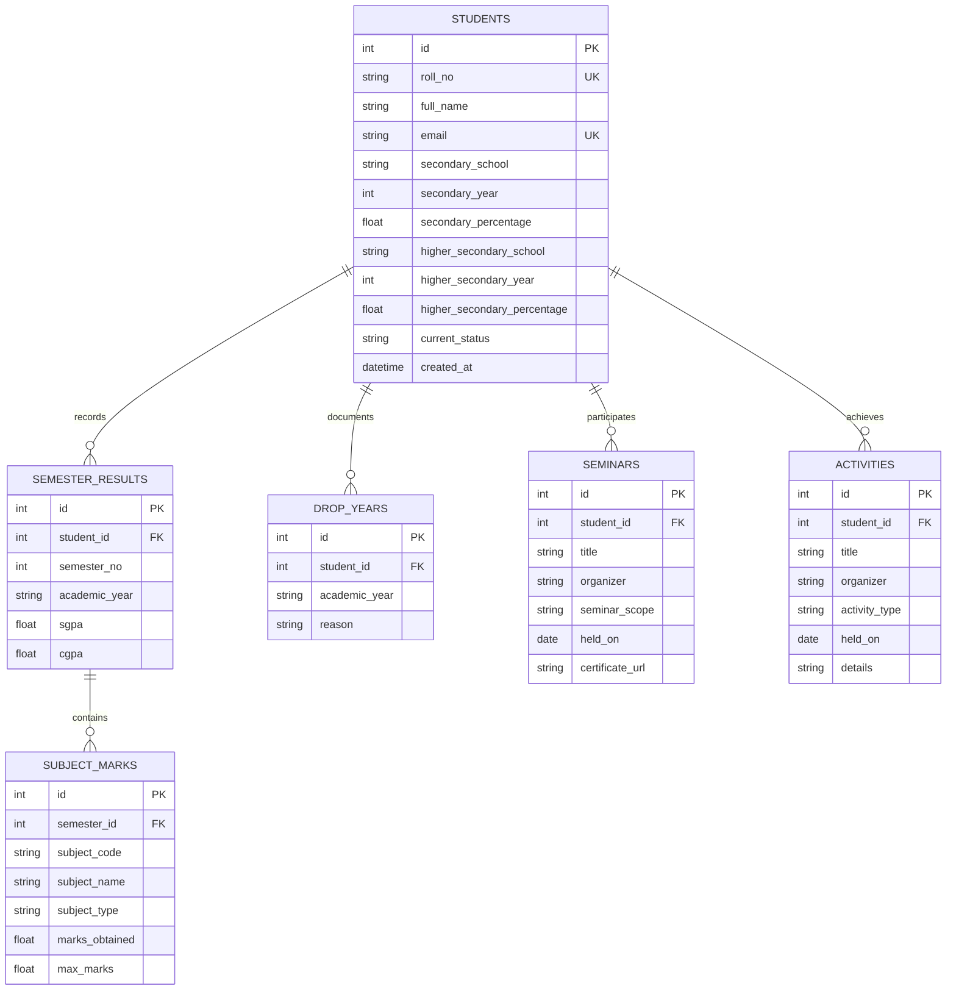

# User & Technical Report
## Student Academic Progression and Portfolio Management System
**College DBMS Mini-Project Final Technical Documentation**

---

### 1. Executive Summary & Objective
Academic institutions require reliable, auditable, and structured record-keeping systems to monitor undergraduate student progression, coursework performance, continuous grade improvements, and non-academic portfolios. 

The **Student Academic Progression and Portfolio Management System** is a normalized relational database application designed to address these requirements. It manages:
- Student demographic and secondary/higher-secondary academic baselines.
- Semester-wise progression including SGPA, CGPA, and granular theory vs. lab course marks.
- Academic interruptions and recorded drop/gap years.
- Extra-curricular and co-curricular portfolios (Seminars, Technical Hackathons, Sports, Leadership).
- Automatic or on-demand one-way data publication to Google Sheets.

---

### 2. Technology Stack & Framework Architecture
- **Language & Runtime**: Python 3.10+
- **Application Framework**: Flask 3.1+ (Jinja2 Template Engine)
- **Object-Relational Mapping (ORM)**: SQLAlchemy 2.0+ (via Flask-SQLAlchemy 3.1+)
- **Relational Databases**:
  - **SQLite**: Local out-of-the-box demonstration engine with enabled foreign-key pragmas.
  - **PostgreSQL**: Production/submission engine with full declarative DDL (`schema.sql`) and binary client bindings (`psycopg 3.3+`).
- **User Interface & Visualization**:
  - Bootstrap 5.3.3 (Responsive College ERP Dashboard Layout)
  - Bootstrap Icons 1.11.3
  - Chart.js 4.4.2 (SGPA/CGPA Trajectory Curves & Student Trend Analytics)
- **External Integration**: Google Sheets API via `gspread` and `google-auth` service account credentials.

---

### 3. Database Normalization & 3NF Schema Analysis

The relational schema is intentionally architected to satisfy **Third Normal Form (3NF)**.



#### Normalization Evaluation:
1. **First Normal Form (1NF)**:
   - All attributes are atomic (no repeating arrays, comma-delimited courses, or nested records).
   - Each table possesses a unique primary key (`id`), with domain integrity maintained on all columns.
2. **Second Normal Form (2NF)**:
   - Meets 1NF.
   - All non-key attributes are fully functionally dependent on the entire primary key. In child tables, surrogate primary keys are paired with composite candidate keys (`UNIQUE(student_id, semester_no)`, `UNIQUE(semester_id, subject_code)`), guaranteeing no partial dependency exists.
3. **Third Normal Form (3NF)**:
   - Meets 2NF.
   - There are no transitive dependencies ($X \rightarrow Y \rightarrow Z$) among non-key attributes. For example, subject marks belong to a specific semester rather than directly referencing the student; seminars and activities are segregated into their own relation rather than existing as repeating fields inside the student entity.

---

### 4. Integrity Constraints & Referential Actions

| Entity / Constraint | Validation Rule | Enforcement Mechanism | Failure Consequence |
| :--- | :--- | :--- | :--- |
| `students.roll_no` | Unique, Non-empty String | `UNIQUE`, `NOT NULL`, Indexed | Transaction rollback; duplicate registration flash error |
| `students.email` | Unique if provided | `UNIQUE`, Nullable | Transaction rollback; duplicate email warning |
| `students.percentages` | $0.00 \le \text{Percentage} \le 100.00$ | `CHECK` Constraint + Server Form Check | Input rejected; user prompted to fix percentage |
| `semester_results.semester_no` | $1 \le \text{Semester} \le 12$ | `CHECK (semester_no BETWEEN 1 AND 12)` | Prevents unrealistic semester values |
| `semester_results.sgpa` | $0.00 \le \text{SGPA} \le 10.00$ | `CHECK (sgpa BETWEEN 0 AND 10)` | Out-of-bounds GPA rejected |
| `semester_results.cgpa` | $0.00 \le \text{CGPA} \le 10.00$ or `NULL` | `CHECK (cgpa IS NULL OR cgpa BETWEEN 0 AND 10)` | Out-of-bounds CGPA rejected |
| `uq_student_semester` | One result per student per semester | Composite `UNIQUE(student_id, semester_no)` | Prevents duplicate semester entries |
| `subject_marks.marks_obtained` | $0 \le \text{Marks} \le \text{Maximum}$ | `CHECK (marks_obtained BETWEEN 0 AND max_marks)` | Rejects impossible marks scores |
| `subject_marks.max_marks` | $\text{Maximum} > 0$ | `CHECK (max_marks > 0)` | Rejects negative or zero maximum marks |
| `subject_marks.subject_type` | `Theory` or `Lab` | `CHECK (subject_type IN ('Theory','Lab'))` | Rejects unauthorized course categories |
| `seminars.seminar_scope` | `Internal` or `External` | `CHECK (seminar_scope IN ('Internal','External'))` | Controlled categorization |
| `activities.activity_type` | `Technical`, `Co-curricular`, `Extra-curricular` | `CHECK (activity_type IN (...))` | Controlled activity types |
| **Cascade Behavior** | Child rows deleted when parent is deleted | `ON DELETE CASCADE` on all Foreign Keys | Prevents orphaned records |

---

### 5. Application User Guide & GUI Operations

#### 5.1 Dashboard (`/`)
- **Key Metrics Overview**: Top summary cards report total students, active enrolled undergraduates, graduated alumni, total semester terms, portfolio counts, and gap years.
- **Dynamic Progression Chart**: Allows administrators or evaluators to select any student from a dropdown menu. The line chart automatically refreshes with SGPA and CGPA trends via an asynchronous JSON API (`/api/student/<id>/progression`).
- **Recent Student Records**: Displays the most recently updated students with quick links to their profiles.

#### 5.2 Student Directory & Search (`/students`)
- Provides real-time query filtering across Roll Number, Full Name, and Email.
- Filter by academic status (`Enrolled`, `Graduated`, `On Leave`, `Discontinued`).

#### 5.3 Student Profile & Academic Dossier (`/student/<id>`)
- Shows Secondary (10th) and Higher Secondary (12th) school qualifications.
- Prominent **Academic Gap Year Banner** if interruptions are recorded.
- Visual line chart of the student's personal grade progression.
- Semester results table with nested theory and lab subject breakdown.
- Segregated tabs for Seminars, Activities, and Gap Years with action controls (Add, Edit, Delete).

#### 5.4 Data Entry & Modification Forms
- **Add / Edit Student** (`/student/new`, `/student/<id>/edit`): Manages student identity, school scores, and enrollment status.
- **Add / Edit Semester & Marks** (`/student/<id>/semester/new`, `/semester/<id>/edit`): Dynamic rows allowing arbitrary numbers of theory subjects and practical labs to be added or removed in real time.
- **Add / Edit Seminar** (`/student/<id>/seminar/new`, `/seminar/<id>/edit`): Tracks workshops, organizers, dates, and certificate links.
- **Add / Edit Activity** (`/student/<id>/activity/new`, `/activity/<id>/edit`): Tracks technical hackathons, debates, sports, and leadership roles.
- **Add / Edit Gap Year** (`/student/<id>/drop-year/new`, `/drop-year/<id>/edit`): Documents the academic year and reason for study pause.

---

### 6. Google Sheets Cloud Synchronization

#### Data Flow Architecture
The synchronization mechanism is designed as a **reliable one-way export** from the database to Google Sheets:
1. When a user performs any Create, Update, or Delete operation in the web interface, `sync_after_write()` is invoked.
2. The function queries all 6 relational models: `Student`, `SemesterResult`, `SubjectMark`, `DropYear`, `Seminar`, `Activity`.
3. If `GOOGLE_SHEET_ID` and `GOOGLE_SERVICE_ACCOUNT_JSON` are present:
   - Authenticates using Google OAuth2 service account tokens.
   - Clears and writes fresh headers and rows to 6 dedicated worksheets: `Students`, `Semesters`, `Subject Marks`, `Drop Years`, `Seminars`, `Activities`.
   - Flashes a success confirmation to the user.
4. **Resilience & Local-First Operation**:
   - If credentials are not configured, the database commit succeeds without interruption and informs the user: `Local DB updated (Sheets sync skipped)`.
   - If network or API quota errors occur, the transaction is not rolled back; a warning message informs the administrator while keeping the local database intact.

---

### 7. Direct Database Administration & SQL Maintenance

Administrators can inspect or update records directly via SQL clients (`psql` or `sqlite3`):

```sql
-- Update student enrollment status upon graduation
UPDATE students 
SET current_status = 'Graduated' 
WHERE roll_no = 'CS21B101';

-- Calculate average SGPA across all students in Semester 1
SELECT 
    academic_year, 
    ROUND(AVG(sgpa), 2) AS average_semester_sgpa,
    COUNT(*) AS total_students_evaluated
FROM semester_results
WHERE semester_no = 1
GROUP BY academic_year;

-- Retrieve all students with recorded academic drop years along with reasons
SELECT 
    s.roll_no, 
    s.full_name, 
    d.academic_year AS gap_year, 
    d.reason
FROM students s
JOIN drop_years d ON s.id = d.student_id;

-- Find highest performing students by latest CGPA
SELECT 
    s.roll_no, 
    s.full_name, 
    r.semester_no, 
    r.cgpa
FROM students s
JOIN semester_results r ON s.id = r.student_id
WHERE r.cgpa >= 9.0
ORDER BY r.cgpa DESC;
```

---

### 8. Testing Checklist & Quality Assurance Results

The project includes an automated test suite (`test_system.py`) that systematically verifies all requirements:

| Test Case | Description | Tested Component | Status |
| :--- | :--- | :--- | :--- |
| `test_01_health_and_dashboard` | Verifies `/health` endpoint and ERP dashboard rendering | `app.py`, `index.html` | ✅ PASS |
| `test_02_students_directory_and_search` | Search by roll number, student name, and status filter | `students_list()`, `students.html` | ✅ PASS |
| `test_03_student_crud_and_validations` | Adds student, tests duplicate roll rejection, tests invalid percentage rejection, edits student | `Student` Model, constraints | ✅ PASS |
| `test_04_academic_progression_and_marks` | Adds semester, theory & lab marks, tests marks $\le$ max marks, edits semester, deletes semester | `SemesterResult`, `SubjectMark` | ✅ PASS |
| `test_05_portfolio_crud` | Adds, edits, and deletes Seminars, Activities, and Drop Years | `Seminar`, `Activity`, `DropYear` | ✅ PASS |
| `test_06_progression_api` | JSON trajectory endpoint providing labels, SGPA, CGPA | `/api/student/<id>/progression` | ✅ PASS |
| `test_07_cascade_delete_student` | Deleting a student cascades cleanly to all child entities | Foreign Key `ON DELETE CASCADE` | ✅ PASS |

**Test Execution Output:**
```
Ran 7 tests in 0.628s
OK
```

---

### 9. Reliability, Security & Future Extensions
- **Server-Side Validation**: All user inputs are sanitized, bounds-checked, and typed before submission to the database.
- **SQL Injection Prevention**: SQLAlchemy parameterized query compilation prevents SQL injection attacks across all endpoints.
- **Credential Safety**: Google Cloud service-account secrets and database URLs are read strictly from environment variables (`.env`) and excluded from source control via `.gitignore`.
- **Confirmation Prompts**: Destructive delete operations on students, semesters, and portfolio entries require explicit user confirmation.
- **Recommended Future Enhancements**: Role-based access control (Admin vs. Student vs. Faculty login) and automated two-way bi-directional Google Sheets sync with queue workers.
